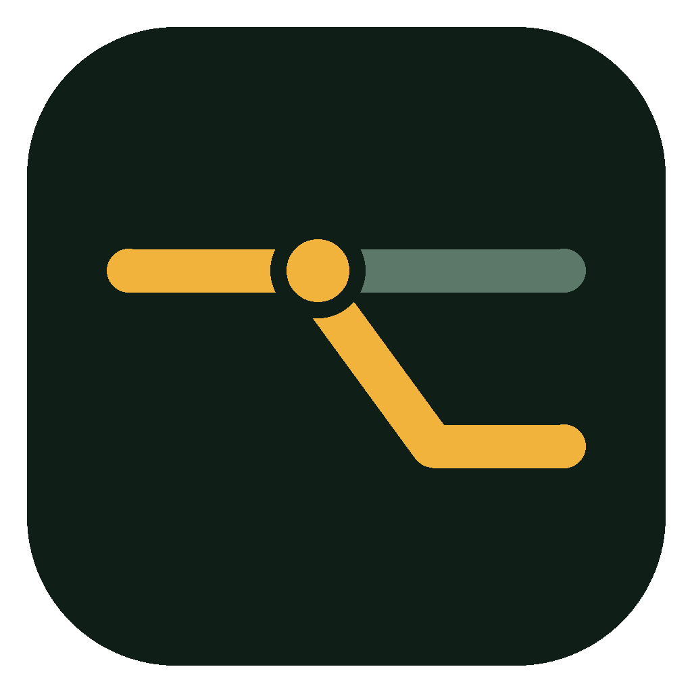
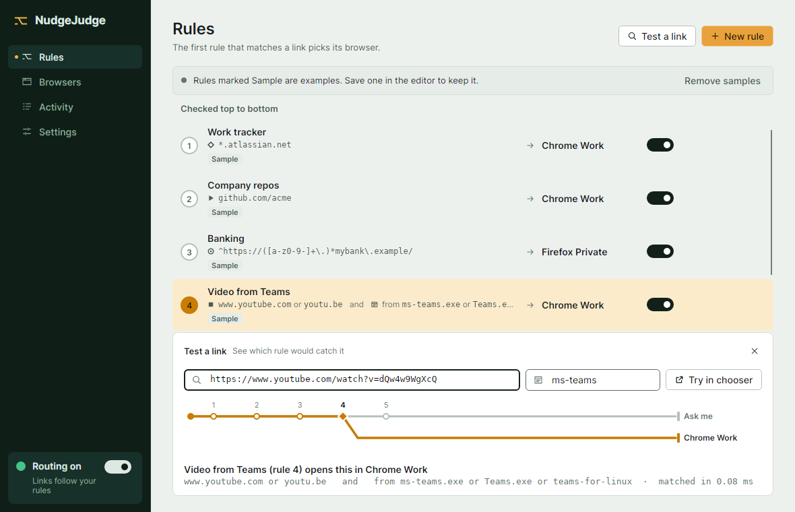
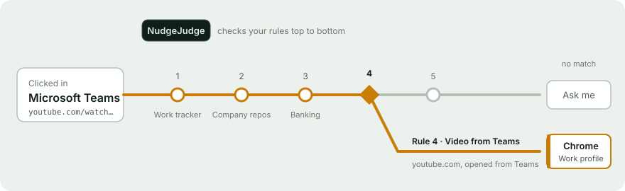
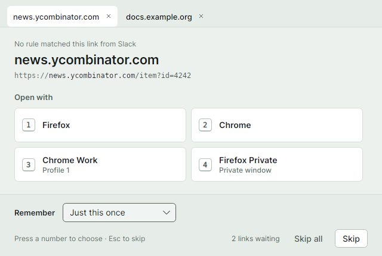
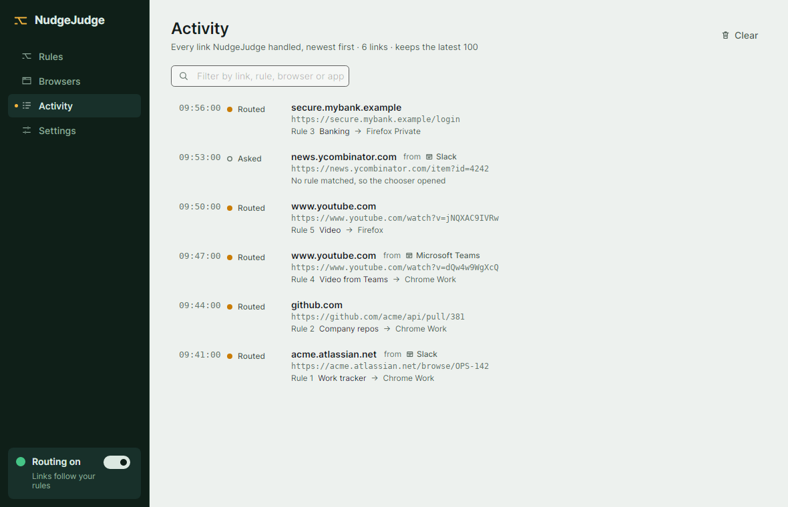
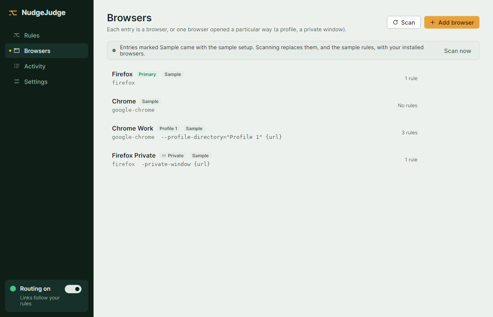
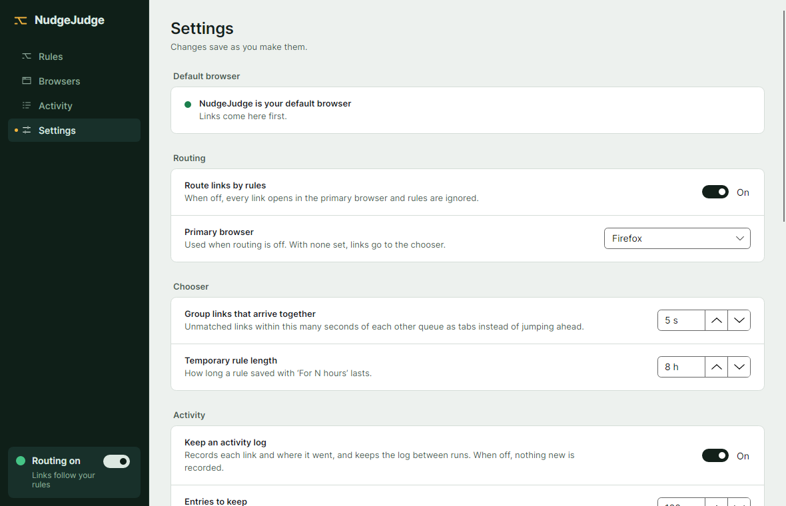

<div align="center">



# NudgeJudge

**A browser router for the desktop.** Every link goes to the right browser, profile or private window.

[](https://github.com/kushagra10025/Nudge-Judge/releases)
[](LICENSE)


[Features](docs/features.md) · [Getting started](docs/getting-started.md) · [Architecture](docs/architecture.md) · [Roadmap](docs/roadmap.md)

</div>

<picture>
  <source media="(prefers-color-scheme: dark)" srcset="docs/images/rules-dark.png">
  
</picture>

## What it does

You set NudgeJudge as your system's default browser. When an app opens a link, NudgeJudge checks it against your rules and opens it where you chose: work links in a Chrome work profile, banking in a Firefox private window, everything else in your usual browser. When no rule matches, a small chooser asks where to open the link, and can save your answer as a rule.



> [!IMPORTANT]
> **Early development.** The UI, rule engine, browser scanning, default-browser registration, start on login (Linux and Windows), single-instance mode and the native (AOT) build work. Packaging and macOS support aren't built yet. See the [roadmap](docs/roadmap.md).

## Highlights

| | |
|---|---|
| 🚦 **Rules, top to bottom** | Named rules with compound conditions (all/any, negation, alternatives). Match by wildcard, exact domain, path prefix or regex, and by time of day or day of week. |
| 🪟 **Knows where a link came from** | "Opened from" conditions match the app you clicked in, e.g. *YouTube from Teams → Chrome Work*. |
| 🧪 **Live rule tester** | Paste a link (<kbd>Ctrl</kbd>+<kbd>T</kbd>) and watch it run past each rule on a route diagram. |
| 🗂️ **Chooser for the rest** | Unmatched links queue as tabs. Press <kbd>1</kbd>–<kbd>9</kbd> to pick, and save the choice for N hours, until restart, or for good. |
| 👤 **Profiles and private windows** | Each browser entry is a program plus arguments. Scanning finds installed browsers, Firefox and Chromium profiles. |
| ⚡ **Fast** | Native AOT build opens a routed link in about **20 ms**; matching 66 rules takes **6.6 µs**. [Details](docs/performance.md) |
| 🔒 **Treats every URL as untrusted** | Strict validation, no shell, ReDoS-safe matching, owner-only files. [Details](docs/security.md) |
| 🔄 **Self-updating** | Checks GitHub Releases and updates in one click (Velopack). |

## Screenshots

<table>
  <tr>
    <td width="50%">
      <picture>
        <source media="(prefers-color-scheme: dark)" srcset="docs/images/chooser-dark.png">
        
      </picture>
      <p align="center"><sub><b>Chooser</b>: pick a browser for links no rule caught</sub></p>
    </td>
    <td width="50%">
      <picture>
        <source media="(prefers-color-scheme: dark)" srcset="docs/images/activity-dark.png">
        
      </picture>
      <p align="center"><sub><b>Activity</b>: every link, the app it came from, and where it went</sub></p>
    </td>
  </tr>
  <tr>
    <td width="50%">
      <picture>
        <source media="(prefers-color-scheme: dark)" srcset="docs/images/browsers-dark.png">
        
      </picture>
      <p align="center"><sub><b>Browsers</b>: profiles, private windows, custom flags</sub></p>
    </td>
    <td width="50%">
      <picture>
        <source media="(prefers-color-scheme: dark)" srcset="docs/images/settings-dark.png">
        
      </picture>
      <p align="center"><sub><b>Settings</b>: default browser, routing, chooser, activity</sub></p>
    </td>
  </tr>
</table>

## Quick start

Requires the [.NET 10 SDK](https://dotnet.microsoft.com/download).

```bash
dotnet run --project NudgeJudge.Desktop                          # open the main window
dotnet run --project NudgeJudge.Desktop -- https://example.com   # simulate the OS handing it a link
dotnet publish NudgeJudge.Desktop -c Release -r linux-x64        # native build (or win-x64)
```

Then open **Settings → Make default**. Full instructions, including the native build's toolchain and first-run samples, are in [Getting started](docs/getting-started.md).

## Documentation

| Doc | What's in it |
|---|---|
| [Features](docs/features.md) | Rules, match types, source-app detection, chooser, activity, updates, default-browser setup |
| [Getting started](docs/getting-started.md) | Build, run, test and first-run setup |
| [Security](docs/security.md) | How untrusted URLs and local messaging are handled |
| [How data is saved](docs/data-storage.md) | Config paths, atomic writes, recovery, Windows gaps |
| [Performance](docs/performance.md) | Benchmarks and how startup and matching stay fast |
| [Architecture](docs/architecture.md) | Project layout and how a link flows through the code |
| [Releasing](docs/releasing.md) | Tagging a release and testing updates locally |
| [Status and roadmap](docs/roadmap.md) | What works, current limitations, what's next |
| [DESIGN.md](DESIGN.md) · [PRODUCT.md](PRODUCT.md) | Design system and product context |

## Contributing

See [CONTRIBUTING.md](CONTRIBUTING.md).

## AI usage

Designed the primary system architecture and built the core library, while Claude provided AI assistance to generate the testing suite and refine the UI presentation.

Skills used:

- UI/UX: [Impeccable](https://github.com/pbakaus/impeccable)
- Agent: [Graphify](https://github.com/Graphify-Labs/graphify)

## License

NudgeJudge is released under the [MIT License](LICENSE).
