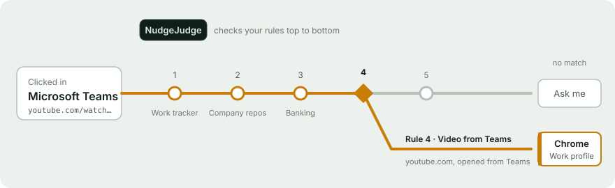

# Architecture

[← Back to README](../README.md)

Built with [Avalonia UI](https://avaloniaui.net/) and .NET 10 (C#), using a strict MVVM structure.



Every incoming link goes through `LinkRouter.Route(string)`. That's the command line of the first launch, and links that later launches forward over the single-instance channel. The router validates the URL, then either passes it through (routing off), matches it against the rules, or asks via the chooser.

## Project structure

```
NudgeJudge.Core/          Plain .NET library with no UI dependencies
  Models/                 Rule, BrowserProfile, AppSettings, AppConfig
  Rules/                  PatternCompiler (pattern → matcher), SourceAppPattern (app name → matcher),
                          RuleEngine (conditions → one predicate, compiled once; ordered matching + per-rule trace;
                          PreparedRules for the router), LinkInput (per-link host/path, worked out once) and StarGlob
                          (regex-free `*` globs)
  Security/               UrlValidator
  Config/                 JsonConfigStore, AppPaths (per-OS paths, private atomic writes), SampleData
  Browsers/               BrowserLauncher (argv-only launch); Discovery/ finds installed browsers, private modes and profiles
  Platform/               SystemBoot (detects reboots for "until restart" rules); SourceAppDetector + per-OS process tables
                          (which app opened the link); default-browser registrars (Linux xdg-mime,
                          Windows registry + Default Apps, macOS stub), AppLaunchCommand, ICommandRunner
  Routing/                LinkRouter (validate → pass through / match / ask), ActivityLog + its rolling file
  Ipc/                    Single instance: InstanceLock, InstanceServer/InstanceClient, wire protocol, Unix socket and named-pipe transports
  CoreServices.cs         The routing half of the app (config, rules, activity log, router) without UI, built before the UI starts

NudgeJudge/               Avalonia UI library
  ViewModels/             CommunityToolkit.Mvvm view models; they reach windows only through interfaces in Services/
  Views/                  MainWindow, the Rules/Browsers/Activity/Settings pages, ChooserWindow
  Controls/               RouteDiagram, MatchKindGlyph, Icon (custom-drawn controls)
  Services/               IWindowService, IDialogService, IThemeService, IUiDispatcher + Avalonia implementations;
                          IUpdateService + its Velopack implementation (GitHub Releases), AppInfo (version, project links)
  Styles/                 Theme.axaml (colour and icon resources), Styles.axaml (shared styles)
  App.axaml(.cs)          Composition root and tray icon

NudgeJudge.Desktop/       Executable for Linux, Windows and macOS; routes launch links before starting the UI; publishes as Native AOT
NudgeJudge.Core.Tests/    xUnit tests for matching, validation, ReDoS safety, argument building, browser discovery and registration
NudgeJudge.UI.Tests/      Avalonia headless tests (xunit v3) that drive real views, e.g. the default-browser setup in Settings
```

## Related docs

- [DESIGN.md](../DESIGN.md): the "Signal Box" design system
- [PRODUCT.md](../PRODUCT.md): product context
- [Performance](performance.md): how startup and matching are kept fast
- [Security](security.md) and [How data is saved](data-storage.md)
