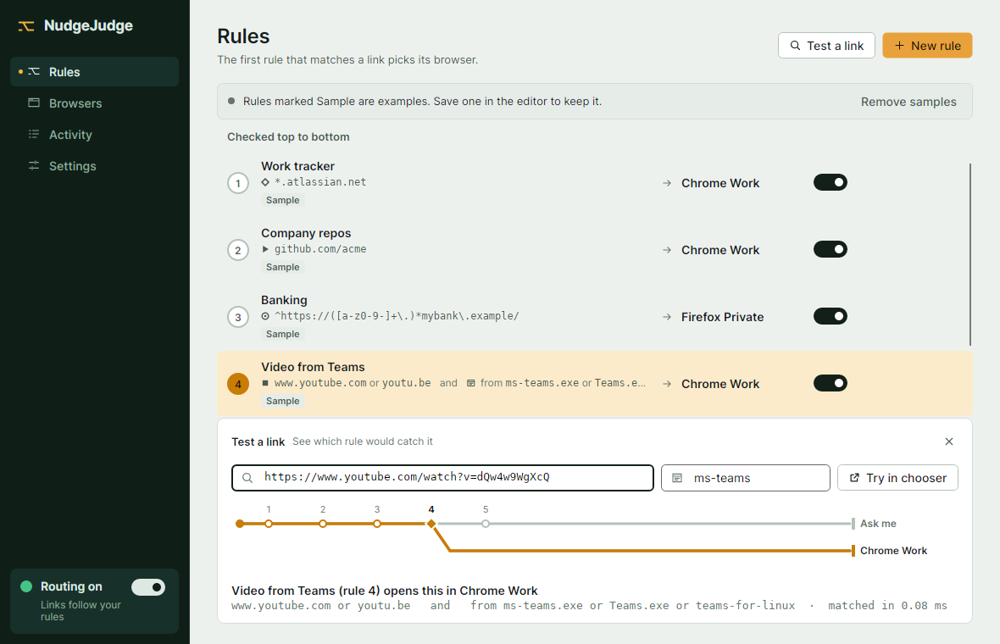
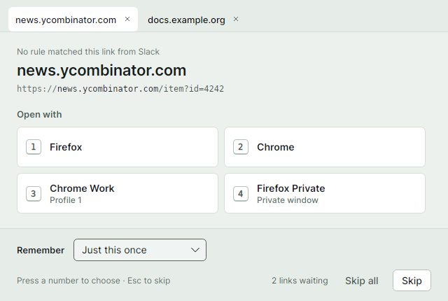
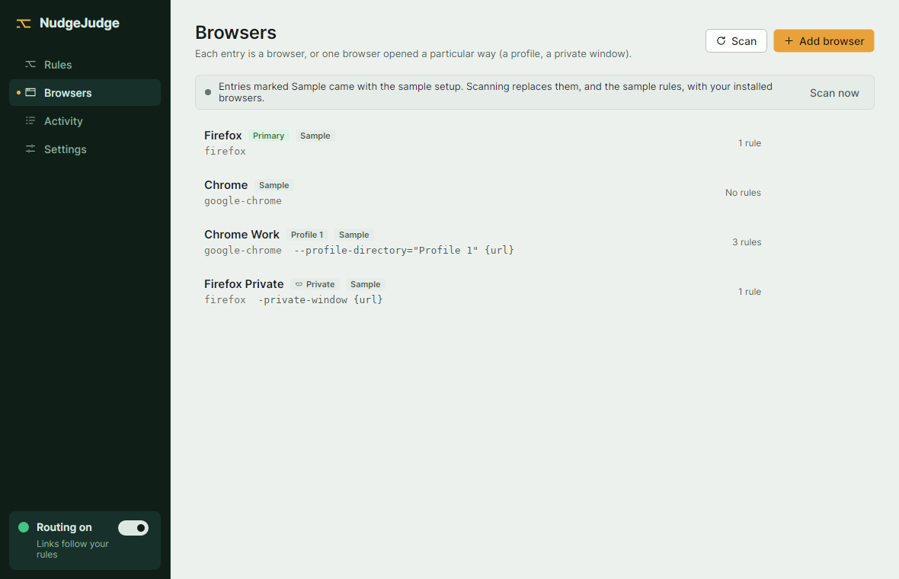
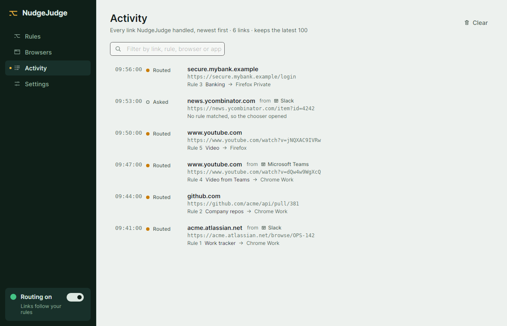
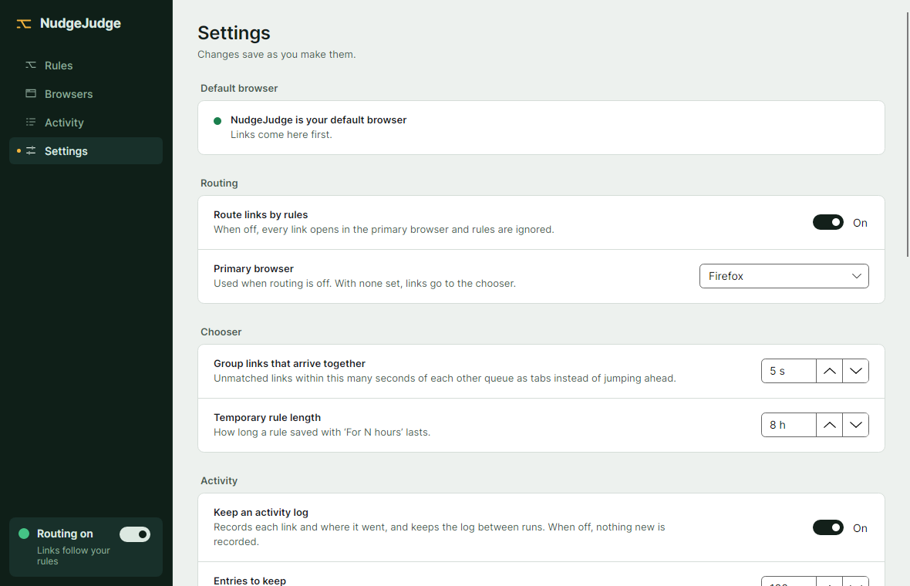

# Features

[← Back to README](../README.md)

<picture>
  <source media="(prefers-color-scheme: dark)" srcset="images/rules-dark.png">
  
</picture>

## Rules, checked top to bottom

The first rule that matches picks the browser. Every rule has a name (shown in the list and in Activity) and one or more conditions, joined by **all** or **any**. Each condition can be negated ("doesn't match", "is not") and holds any number of alternatives, OR'd together.

For example, *YouTube from Teams*: link is `www.youtube.com` or `youtu.be`, **and** opened from `ms-teams.exe`, opens in Chrome. A plain *YouTube* rule below it then sends every other YouTube link to Firefox.

### Link conditions

Each link condition uses one of four match types:

| Match type | Example | Notes |
|---|---|---|
| **Wildcard** | `*.atlassian.net`, `github.com/acme/*` | A leading `*.` also matches the bare domain |
| **Exact domain** | `www.youtube.com` | |
| **Path prefix** | `github.com/acme` | Matches `/acme` and `/acme/…` but not `/acmecorp` |
| **Regular expression** | `^https://([a-z0-9-]+\.)*mybank\.example/` | Matched against the full URL |

### "Opened from" conditions

These match the app the link was clicked in: a program name with or without `.exe` (`ms-teams`, `slack`), its title (`Microsoft Teams`), a pattern (`*teams*`) or a full path. Program names you've seen in Activity are suggested as you type.

### Time conditions

These match the local time a link is opened: hours (`09:00-17:00`, `9am-5pm`), days (`Mon-Fri`, `Sat,Sun`, `weekdays`, `weekends`), or both (`Mon-Fri 09:00-17:00`). The end time is exclusive, and overnight windows work: `Fri 22:00-02:00` covers Friday night into early Saturday. Use "is outside" to match the rest of the time.

For example, *GitHub at work*: link is `github.com` **and** time is within `Mon-Fri 09:00-17:00`, opens in Chrome. A plain *GitHub* rule below it sends GitHub links to Firefox the rest of the time. The tester checks time conditions against the current time.

### Cloning rules

**Clone** (on a rule's hover actions) copies the rule to just below the original as "*name* (copy)" and opens it in the editor. While the copy still does exactly what the original does (same conditions and browser), it shows a **Duplicate of *n*** badge; clicking it scrolls to the original and highlights it. Renaming doesn't count as a change. Once either rule is saved with different conditions or a different browser, the badge goes away for good.

## Source app detection

When an app opens a link, NudgeJudge walks up its own process tree past openers and shells (`xdg-open`, `gio`, `sh`, `OpenWith.exe`, …) to the app that started it. If that chain is broken (the opener exited first), it falls back to the app that owns the foreground window (Windows), then to the `CHROME_DESKTOP` hint Electron apps leave in the environment (Linux).

Friendly names come from the program's file description (Windows) or its `.desktop` file (Linux). Detection is best effort: when it can't tell, the link still routes, and "opened from" conditions simply don't match. A link forwarded to the running instance carries the source with it.

## Live rule tester

Open **Test a link** on the Rules page (<kbd>Ctrl</kbd>+<kbd>T</kbd>), paste a link (and optionally the app it came from), and a route diagram shows it running past each rule, which rule caught it, and how long matching took.

## Chooser for unmatched links

<picture>
  <source media="(prefers-color-scheme: dark)" srcset="images/chooser-dark.png">
  
</picture>

Links that arrive in a burst queue up as tabs. Press <kbd>1</kbd>–<kbd>9</kbd> to pick a browser and <kbd>Esc</kbd> to skip. You can open a link once, or save the choice as a rule for N hours, until restart, or permanently. When the chooser knows which app the link came from, it can limit the saved rule to links from that app.

## Browser profiles

<picture>
  <source media="(prefers-color-scheme: dark)" srcset="images/browsers-dark.png">
  
</picture>

Each entry is a program plus arguments, so one browser can appear several times: a specific profile, a private window, extra flags.

**Browser scanning** finds what's installed: Linux `.desktop` entries (including Snap and Flatpak) and Windows `StartMenuInternet`, with a private-window entry per browser, Firefox profiles (both `profiles.ini` and the new profile manager) and Chrome/Chromium-family profiles when there's more than one.

## Activity log

<picture>
  <source media="(prefers-color-scheme: dark)" srcset="images/activity-dark.png">
  
</picture>

Shows every link handled, the app it was opened from, and the rule or choice that sent it where it went. It's kept between runs in `activity.log` next to the config (one JSON object per line, owner-only).

- **Settings → Activity** sets how many entries to keep (100 by default; the oldest are deleted past that) or turns logging off.
- **Create rule** on an entry opens the rule editor with a pattern suggested from the link and the browser it went to; "Opened from" then starts with that entry's app.

## Tray menu

Turn routing on or off (when off, links go straight to your primary browser), open the app, or quit.

## Themes

Light and dark themes, following the system by default.

## Updates

Installed copies check GitHub Releases on startup, daily or weekly (**Settings → Updates**, or "Check now"). A new release shows a dismissable notice above the routing switch in the sidebar. "Update and restart" downloads it (as a small delta when possible), installs it and restarts. Nothing is downloaded until you click. **Settings → About** shows the version and project links.

## Default-browser setup

<picture>
  <source media="(prefers-color-scheme: dark)" srcset="images/settings-dark.png">
  
</picture>

From **Settings → Make default**:

- **Linux:** installs `~/.local/share/applications/nudgejudge.desktop` and makes it the `x-scheme-handler/http` and `https` default via `xdg-mime`. It deliberately does not claim `text/html`, so local HTML files keep opening in a real browser.
- **Windows:** registers NudgeJudge per user (HKCU, no admin) as a browser with Capabilities, then opens *Default apps*. Windows only lets the user pick the default, so you click "Set default" there. NudgeJudge checks again when you return to its window.

Status is checked whenever the main window comes forward, and catches a half registration (only HTTP or only HTTPS) and a stale one (the app moved since registering).

## Launch at startup

Switched in Settings: an XDG autostart entry on Linux, a per-user `Run` value on Windows. It starts in the tray (`--background`), follows the app if it moves, and reflects changes made in the system's own startup settings.
